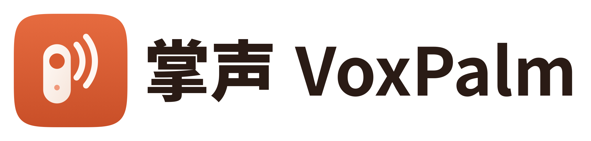

  

<strong>按住说话，松手出字</strong> 把遥控器和无线麦，变成 Mac 的语音按钮

> 开发中，还没有可以下载的版本。

## 它做什么

手里拿着遥控器或别在衣服上的无线麦，按一下就开始说话，松手文字就出现在光标所在的地方。也可以给每个按键设置单击、双击、长按的动作，用来控制录音和剪辑软件。

- **语音编程**：靠在椅子上按住说话，给 AI 编程工具下指令，不用凑到键盘前。
- **办公输入**：接豆包、微信、Typeless、Handy 等输入工具，也可以用内置的本地转写。
- **录音剪辑**：在录音和剪辑软件里开始、停止录音，播放，打标记。

控制设备和收音设备可以分开选：比如用遥控器操作，用专业麦克风收音。

## 设备

每款设备的按键能不能被 Mac 读到，都要逐台实测，不默认所有按键都能用。

| 设备 | 状态 | 代码 |
|---|---|---|
| DJI Mic 2 | 原型已实测：收音、转写、按键开始和停止 | 闭源模块，免费版可用 |
| DJI Mic Mini | 待实测 | 闭源模块，免费版可用 |
| 小米蓝牙遥控器 2 / 2 Pro | 计划中 | 开源 |
| Apple Siri Remote（按键和触摸面） | 计划中 | 开源 |
| 翻页笔、脚踏板等通用按键设备 | 计划中 | 开源 |
| iPhone / iPad / Apple Watch（掌声遥控 App：触控板 + 按住说话） | 计划中 | 开源 |

## 免费版和 Pro

免费版不限时间、不限次数，一套设备就能完整用上「按键 → 说话 → 出字」。Pro 是一次买断，主要给多设备、多场景和录音剪辑工作流。详见 [docs/免费版与Pro.md](docs/免费版与Pro.md)。

## 开源与许可

- 本仓库的代码按 [GPL-3.0-only](LICENSE) 开源。
- DJI 等新设备的适配模块、Pro 功能是闭源的，不在本仓库。
- 名字、Logo、图标和宣传素材是专有品牌素材，见 [BRAND-LICENSE.md](BRAND-LICENSE.md)。

完整的划分见 [docs/开源范围与许可.md](docs/开源范围与许可.md)。想参与的话请先看 [CONTRIBUTING.md](CONTRIBUTING.md)。

---

VoxPalm turns remotes and wireless mics into a push-to-talk button for your Mac. Work in progress.
