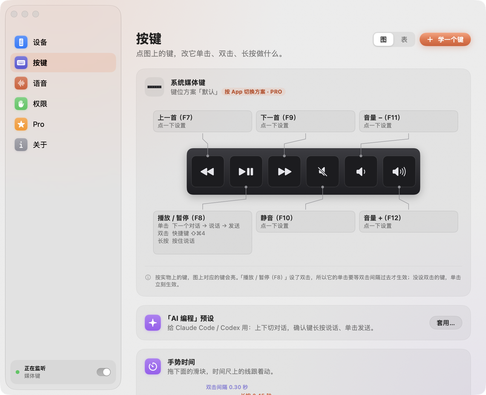
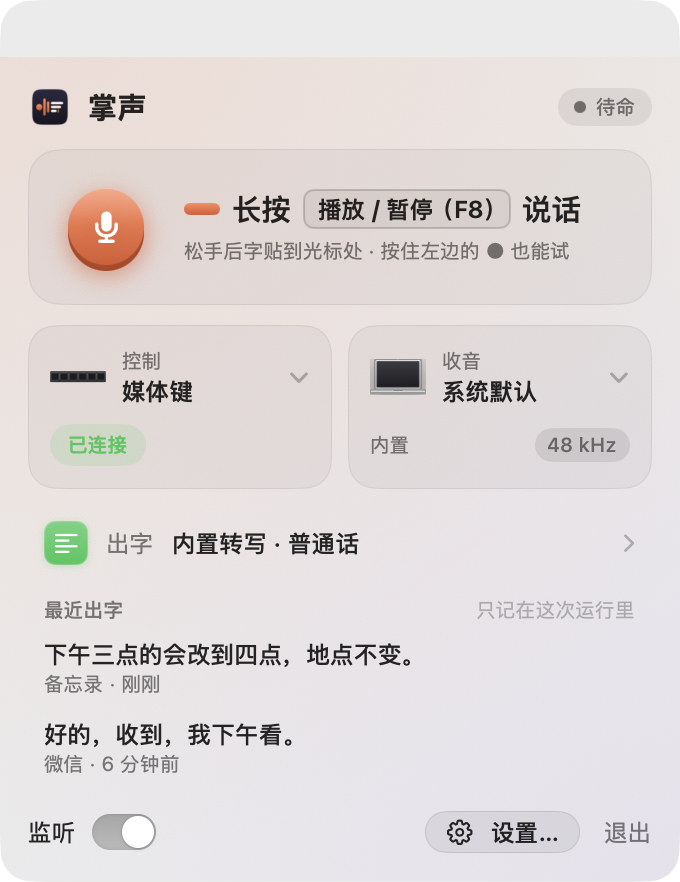
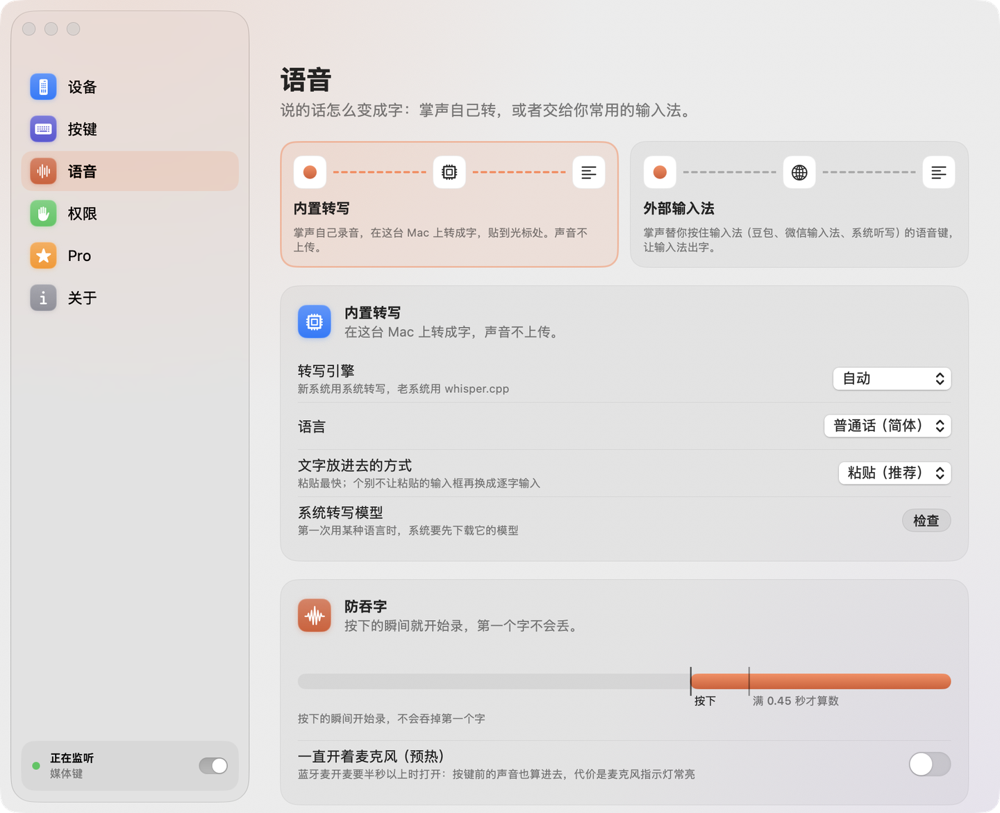

<div align="center">

<picture>
  <source media="(prefers-color-scheme: dark)" srcset="brand/wordmark/VoxPalm-lockup-dark.png">
  
</picture>

### 按住说话，松手出字

把遥控器和无线麦，变成 Mac 的语音按钮

[](LICENSE)
[](#从源码编译)
[](Packages/VoxPalmCore)


**简体中文** · [繁體中文](README.zh-TW.md) · [English](README.en.md) · [日本語](README.ja.md)

</div>

> [!NOTE]
> 开发中。可以下载[公开测试版](https://github.com/Sorasukiawa/VoxPalm/releases)先试用：还没有经过苹果公证，第一次打开要在「系统设置 › 隐私与安全性」里点「仍要打开」，步骤见发布说明。也可以[从源码编译](#从源码编译)。

<p align="center">
  <picture>
    <source media="(prefers-color-scheme: dark)" srcset="docs/screenshots/settings-keys-dark.png">
    
  </picture>
</p>

## 它做什么

手里拿着遥控器，或者衣服上别着无线麦，按住键说话，松手文字就出现在光标所在的地方。每个键还能设单击、双击、长按，用来切对话、按快捷键、控制录音和剪辑软件。

- **语音编程**：靠在椅子上按住说话，给 Claude Code、Codex 这类 AI 编程工具下指令；遥控器上下键切对话，确认键长按说话、单击发送。
- **办公输入**：接豆包、微信、Typeless、Handy 等输入工具，也可以用内置的本地转写。
- **录音剪辑**：在录音和剪辑软件里开始、停止录音，播放，打标记。

## 特点

- **控制和收音分开选**：比如用遥控器操作，用专业麦克风收音。
- **两种出字方式**：内置转写在这台 Mac 上把话转成字，声音不上传（macOS 26 以上用系统转写，更老的系统用 whisper.cpp）；也可以交给你常用的输入法，掌声替你按住它的语音键。
- **不吞第一个字**：按下键的那一刻就开始录，长按成立才算数，短按自动丢掉。
- **只贴进对的地方**：只贴进按键时光标所在的那个输入框，密码框不贴；贴不了就放进剪贴板，浮窗提示按 ⌘V。
- **一个键多种用法**：每个键的单击、双击、长按，可以设成按住说话、快捷键、一段文字、媒体键、打开 App。
- **照着示意图设键**：设置里画着设备的示意图，按一下实物上的键，图上对应的键会亮。

<p align="center">
  <picture>
    <source media="(prefers-color-scheme: dark)" srcset="docs/screenshots/panel-dark.png">
    
  </picture>
  &nbsp;
  <picture>
    <source media="(prefers-color-scheme: dark)" srcset="docs/screenshots/settings-voice-dark.png">
    
  </picture>
</p>
<p align="center"><sub>左：点菜单栏图标弹出的面板　　右：设置 › 语音</sub></p>

## 设备

每款设备的按键能不能被 Mac 读到，都要逐台实测，不默认所有按键都能用。

| 设备 | 状态 | 代码 |
|---|---|---|
| DJI Mic 2 | 已实测（发射器蓝牙直连 Mac，固件 04.02.01.13）：录制键、连接键、电源键单击，按键和收音可以同时用；做不了双击，它的麦没声音时录音自动改用 Mac 麦克风 | 闭源模块，免费版可用 |
| DJI Mic Mini | 待实测 | 闭源模块，免费版可用 |
| 小米蓝牙遥控器 2 / 2 Pro | 计划中 | 开源 |
| Apple Siri Remote（按键和触摸面） | 计划中 | 开源 |
| 翻页笔、脚踏板等通用按键设备 | 计划中 | 开源 |
| iPhone / iPad / Apple Watch（掌声手机版：触控板 + 按住说话） | 计划中 | 开源 |

手上的设备不在表里？可以用[设备探针](tools/probe/README.md)测一下它的按键和收音，把报告发到 issue，见[参与贡献](#参与贡献)。

## 从源码编译

需要 macOS 14 以上和完整的 Xcode（目前用 Xcode 27 验证过）。在仓库根目录运行：

```bash
git clone https://github.com/Sorasukiawa/VoxPalm.git
cd VoxPalm
env -u VOXPALM_PRIVATE_DIR bash scripts/build-app.sh
open build/VoxPalm.app
```

第一次打开会有引导：打开「输入监控」「辅助功能」「麦克风」三个权限 → 选控制设备和收音设备 → 按一下设备上的键设成说话键，当场试一句。

核心库和设备探针的测试分别运行：

```bash
swift test --package-path Packages/VoxPalmCore
swift test --package-path tools/probe
```

测试通过只覆盖代码里的用例；设备兼容性以上面表里逐台实测的记录为准。更多说明和代码结构见 [App/README.md](App/README.md)。

## 路线图

| 版本 | 内容 |
|---|---|
| 0.1 内测 | Mac 端核心：按键 → 动作、按住说话、切麦和预录、外部输入法桥接、内置转写；DJI Mic 2 / Mini、通用按键设备 |
| 0.2 内测 | 手机版：iPhone / iPad 触控板 + 按住说话，Apple Watch 说话键 |
| 0.3 内测 | 小米蓝牙遥控器 2、Siri Remote；Pro 功能：多套键位、按 App 切换、录音剪辑动作包、转写增强 |
| 1.0 正式版 | iOS 上架、Pro 开卖、官网 |

## 免费版和 Pro

免费版不限时间、不限次数，一套设备就能完整用上「按键 → 说话 → 出字」，支持的设备也不分版本。Pro 是一次买断，主要给多设备、多场景和录音剪辑工作流。详见 [docs/免费版与Pro.md](docs/免费版与Pro.md)。

## 参与贡献

现在最需要的是设备实测：用[设备探针](tools/probe/README.md)跑一遍 `voxpalm-probe wizard`，把生成的报告附在 issue 里。被采纳的实测报告会送 Pro 授权。

提交代码前需要签贡献者授权协议（CLA），流程就位前暂不合并外部代码。详见 [CONTRIBUTING.md](CONTRIBUTING.md)。

## 开源与许可

- 本仓库提供 macOS 主程序、按键与语音引擎、设备适配框架和设备探针的源码，按 [GPL-3.0-only](LICENSE) 开源，不带私有模块也能构建。
- DJI 等新设备的适配模块、Pro 功能单独维护，是闭源的，不在本仓库。
- 名字、Logo、图标和宣传素材是专有品牌素材，见 [BRAND-LICENSE.md](BRAND-LICENSE.md)。

完整的划分见 [docs/开源范围与许可.md](docs/开源范围与许可.md)。
